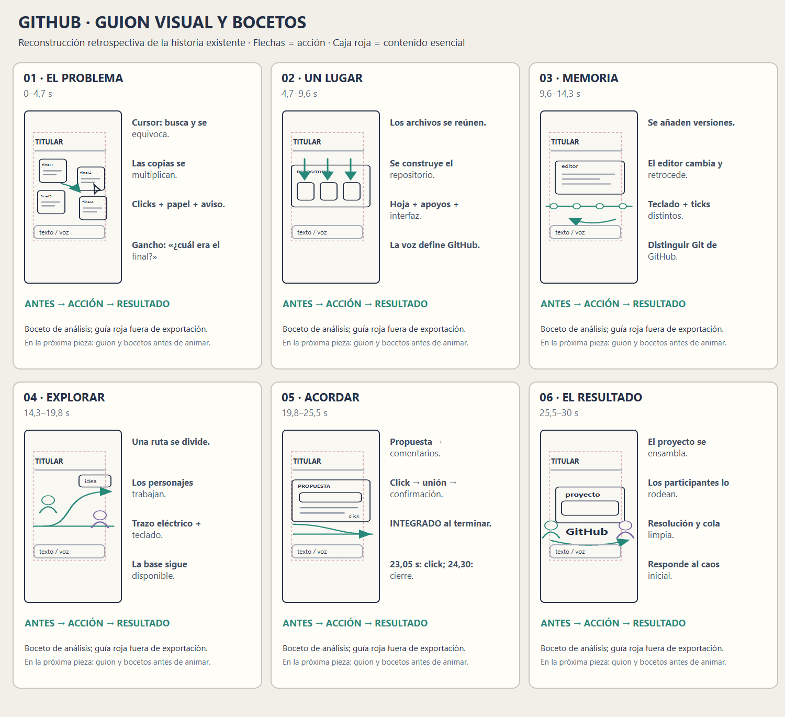

# Caso de estudio: explicar GitHub en 30 segundos

## Alcance

Este caso documenta un prototipo vertical breve para personas que conocen el desorden de las copias `final`, `final_2` y `ahora_si`, pero no necesariamente GitHub. La pieza no muestra una interfaz de servicio auténtica: escenario, archivos, cursor y personajes son dibujos conceptuales programados.

El caso reúne historia, guion, bocetos, movimiento, zonas de trabajo, voz, Foley, mezcla, revisión y correcciones. Sirve para estudiar decisiones y límites; **no es una plantilla de escenas, estilo o tecnología**. El storyboard es una reconstrucción retrospectiva del montaje existente, no prueba de que se bocetara antes.

El dibujo vectorial editable está en [`storyboard.svg`](../assets/caso-github/storyboard.svg). Las flechas muestran acciones y la caja roja punteada, el área de contenido esencial usada en la revisión del boceto; esa guía no forma parte del video.

## 1. Promesa y conexión con el público

La situación elegida es cotidiana: se guardan copias de un trabajo y luego no se sabe cuál contiene la versión correcta. La promesa no es que GitHub arregle por sí solo cualquier desorden; es comprender de manera breve cómo repositorios, historial, ramas y revisión pueden ayudar a organizar y compartir cambios.

El gancho verbal dice: **«¿Otra vez final, final dos, ahora sí? Hay una forma mejor.»** Es una invitación a reconocer una pequeña frustración. La imagen comienza con copias que se acumulan y un cursor que busca. El cierre responde con un proyecto organizado: **«Menos caos. Tu código, su historia, tu equipo.»**

La prueba es narrativa, no experimental: se eligió por reconocibilidad y progresión. No existen datos de retención o alcance que permitan afirmar que el gancho mejora resultados de redes.

Git y GitHub se distinguen: Git registra cambios como sistema de control de versiones; GitHub aloja proyectos Git y agrega posibilidades de colaboración. Una metáfora visual puede condensar la explicación, pero no debe confundirse con la interfaz o funcionamiento literal del producto. La [documentación oficial de GitHub](https://docs.github.com/en/get-started/start-your-journey/what-is-github) explica la diferencia.

## 2. Personaje y mundo visual

El cursor es el protagonista funcional: busca una copia, selecciona, se equivoca y continúa hacia el repositorio. Su trayectoria crea una acción que un espectador reconoce sin conocer código. Dos participantes aparecen cuando la historia requiere mostrar trabajo paralelo y revisión; no son retratos de personas reales ni testimonios.

El mundo usa una retícula, rutas, luz, capas y pequeños elementos de proyecto para crear densidad tecnológica. El detalle ambiente conserva menor energía que archivos, cursor, historial y texto. La cámara descubre un sistema compartido, en vez de presentar una serie de carteles con transiciones idénticas.

La caja editorial central permite leer texto, pero la escena y el ambiente continúan hasta el borde. Así el perfil de seguridad no se convierte en una gran banda vacía. Una transición parte de un nodo y revela el fondo de la siguiente escena; el cambio de plano no desplaza simplemente toda la lámina como diapositiva.

## 3. Guion audiovisual

| Momento | Función | Voz | Acción principal |
|---|---|---|---|
| 0–4,7 s | Gancho y conflicto | «¿Otra vez final, final dos, ahora sí? Hay una forma mejor.» | Las copias se multiplican. El cursor selecciona una y aparece que no era esa versión. |
| 4,7–9,6 s | Presentar el lugar común | «GitHub aloja tu código en repositorios para colaborar.» | Los archivos encuentran posiciones dentro de un repositorio. |
| 9,6–14,3 s | Explicar historial y distinción | «Git registra cambios. GitHub permite compartir ese historial.» | Se agrega una versión al historial y el editor vuelve a otra. |
| 14,3–19,8 s | Abrir alternativa | «Prueba ideas en ramas, sin cambiar todavía la base.» | Una ruta se bifurca; dos participantes trabajan. |
| 19,8–25,5 s | Revisión y acuerdo | «Propón cambios, revísalos con tu equipo e integra lo que acuerden.» | Aparece una propuesta, comentarios, acción de integración y resultado. |
| 25,5–30 s | Recompensa | «Menos caos. Tu código, su historia, tu equipo.» | Se ensambla el proyecto y aparece el cierre. |

El lenguaje distribuye la información: la voz explica, la imagen muestra una operación y el texto ancla conceptos breves. No se duplica cada frase de voz como párrafo en pantalla. Los subtítulos SRT siguen frases; no son una alineación por palabra.

## 4. Del storyboard retrospectivo al flujo siguiente

La animación precedió al guion en esta prueba, así que se escribió el texto para una duración y acciones existentes. Se registra como excepción para que las personas no infieran el orden equivocado al observar el material.

En una producción nueva, el aprendizaje propone este orden conceptual:

1. Acordar público, experiencia reconocible, objetivo y promesa.
2. Escribir guion audiovisual: qué se dice, qué se ve, qué se lee, qué suena y qué cambia.
3. Bocetar escenarios, escala, personajes, textos, trayectoria de cámara y área esencial.
4. Ordenar los bocetos en storyboard con antes, acción y consecuencia.
5. Dar tiempos de lectura y una prueba de voz/sonido en una animática.
6. Construir escenarios y animación; ajustar la dirección de movimiento.
7. Completar mezcla y captions, después revisar la pieza entera y el destino.

Una adaptación posterior de un clip existente puede invertir algunos pasos, siempre que se documente qué estaba resuelto y qué se adaptó. El sketch del caso en esta carpeta es retrospectivo y sirve para analizar acciones y encuadres, no como evidencia de preproducción.

## 5. Mapa sonoro de la prueba

Las acciones importantes tienen familias diferenciadas: clics al seleccionar, roce y pliegue para el cambio de hoja, escritura/teclado para el trabajo, aire como puente espacial, ticks para cambios del historial, textura de recorrido eléctrico y confirmación al terminar la integración. La cama musical combina pad, bajo y percusión; no imita cada acción con una nota de piano.

El calendario documentado incluye clics de selección a **1,90 s** y **3,10 s**, y un clic de integración a **23,05 s**. El botón cambia a estado **INTEGRADO a 24,30 s**, en el momento de la confirmación, y no antes. Los movimientos de cursor sin presión visible no reciben clicks repetidos. Partículas, retícula y detalles ambiente se agrupan para evitar un efecto por elemento decorativo.

Los tiempos editoriales se distinguen de mediciones de audio. `sound_peak_reference` es una referencia temporal/diseñada, no un pico verdadero medido. El calendario, las pistas aisladas y las mediciones del render permiten reconstruir las decisiones, pero no aprueban el timbre sin escucha.

## 6. Voz y mezcla

Se generaron tomas de voz en español con Kokoro a partir de un modelo que ya estaba disponible localmente, segmentadas para poder corregir frases por separado. La pronunciación de GitHub se orientó para una lectura en español sin cambiar la escritura visible. La prueba no descargó modelos ni dependió de una voz externa en red durante esa generación.

Las duraciones medidas fueron aproximadamente: gancho 3,33 s; repositorio 3,18 s; historial 3,76 s; ramas 3,08 s; revisión 3,77 s; cierre 2,68 s. Las ventanas de escena incluyen respiración y pausas, por lo que no son iguales a la longitud hablada. Cambiar cualquier frase requiere volver a revisar el espacio disponible y la sincronía de captions.

La mezcla conserva stems de narración, música y efectos. Durante voz, la música se atenúa y los efectos se reducen ligeramente. El render con voz midió **−16,37 LUFS integrados y −1,78 dBTP**; el archivo sin voz **−16,75 LUFS y −1,59 dBTP**. Son valores observados en estas versiones, no objetivos universales ni evidencia de agrado. La naturalidad, pronunciación y balance subjetivo requieren escuchar el archivo final.

## 7. Zonas de revisión

El taller de esta producción usó una caja para contenido esencial en 1080×1920: **x=96–900, y=240–1450**. El fondo y el decorado se extendían fuera de ella. Un control interno revisó cajas de texto instrumentadas en 12 momentos de alta legibilidad.

Ese resultado no comprueba cada trayectoria, cada glifo transformado ni la vista real de TikTok, Instagram o YouTube. La caja es un perfil editorial de taller, no la zona oficial de anuncios u orgánico de una plataforma. Antes de publicar una variante, hace falta su perfil de interfaz y una prueba móvil. La zona de una imagen fija, portada o miniatura debe tratarse por separado.

## 8. Revisión y correcciones

La revisión independiente encontró dos fallos de causalidad: los clicks iniciales no aterrizaban en los controles de forma suficientemente explícita y la palabra **INTEGRADO** aparecía antes de que terminara la unión. La escena se ajustó para que el cursor toque las tarjetas y la etiqueta espere hasta 24,30 s, junto con la resolución sonora. La caja de cierre y la tipografía también se verificaron en las muestras centrales.

El render final se inspeccionó como archivo completo. Ambas versiones duran **30,000 s**, tienen **1080×1920**, **30 fps**, **900 cuadros**, H.264 y AAC estéreo a 48 kHz, y se decodificaron sin errores.

Una prueba instrumental del audio pudo comparar familias espectrales, medir niveles y revisar el tiempo entre eventos; la correlación temporal de eventos examinados fue de 0 ms contra la marca del archivo codificado. Eso respalda el reloj compartido y la colocación temporal, pero no resuelve naturalidad ni aprobación auditiva. La capacidad de revisión de esta sesión no permitió escuchar audio directamente; una escucha humana final sigue pendiente.

## 9. Aprendizajes transferibles y no transferibles

**Transferibles como preguntas:** ¿el gancho expresa una experiencia concreta?, ¿el personaje modifica la escena?, ¿la consecuencia visual completa la promesa?, ¿el sonido representa la acción y coincide con el cambio de estado?, ¿el perfil de pantalla fue verificado para el destino real?, ¿el render demuestra solo formato o también se revisó perceptivamente?

**Particulares a este caso:** 30 segundos, escena de versiones finales, cursor, personajes, guion, voz Kokoro, paleta, tiempos de click, sonido electrónico y caja de taller. No son valores predeterminados para futuros encargos.

**No demostrado:** que el estilo sea viral, que el guion aumente retención, que una métrica de sonoridad certifique una buena mezcla, o que la caja de taller evite todos los overlays reales. El prototipo es evidencia de proceso y correcciones concretas, no de rendimiento comercial.

**Prueba de comprensión que se puede hacer en futuras revisiones:** después de ver la pieza una vez, preguntar a una persona qué hace Git y qué aporta GitHub, y cómo permiten las ramas y la revisión trabajar sin perder la base. La respuesta ofrece una señal cualitativa sobre claridad; no reemplaza una prueba con más audiencia ni una comparación experimental de versiones.
